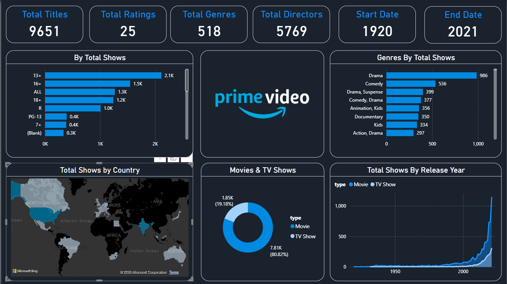

# 🎬 Amazon Prime Video – Power BI Dashboard

## 📌 Project Overview

This project is an interactive **Amazon Prime Video Analytics Dashboard** created using Microsoft Power BI. It provides insights into Prime Video's content library, including movies, TV shows, genres, ratings, directors, countries, and release years.

The dashboard uses interactive visualizations to make content analysis easier and more meaningful.

## 📊 Dashboard Preview



## 🎯 Project Objectives

- Analyze the total number of movies and TV shows.
- Understand content distribution by ratings.
- Identify the most popular genres.
- Analyze content distribution across different countries.
- Explore movies and TV shows by release year.
- Understand the distribution of content types.

## 📈 Key Performance Indicators (KPIs)

| KPI | Value |
|---|---:|
| Total Titles | 9,651 |
| Total Ratings | 25 |
| Total Genres | 518 |
| Total Directors | 5,769 |
| Start Year | 1920 |
| End Year | 2021 |

## 📊 Visualizations Used

1. **Total Shows by Rating** – Displays the distribution of content across different age ratings.
2. **Genres by Total Shows** – Shows the most frequently represented genres.
3. **Total Shows by Country** – Geographical distribution of Prime Video content.
4. **Movies vs TV Shows** – Donut chart comparing movies and TV shows.
5. **Total Shows by Release Year** – Analyzes content releases over time.
6. **Prime Video Branding** – Provides a central visual identity for the dashboard.

## 🛠️ Tools & Technologies

- Microsoft Power BI
- Power Query
- DAX (Data Analysis Expressions)
- Data Cleaning & Transformation
- Data Visualization

## 💡 Key Insights

- The dashboard contains 9,651 titles.
- Movies account for approximately 80.82% of the content.
- TV Shows account for approximately 19.18%.
- Drama is the leading genre with 986 shows.
- The content library includes titles released between 1920 and 2021.
- Content additions increased significantly in recent years.

## 📂 Project Structure

```text
Amazon-Prime-Video-Dashboard/
│
├── prime-video-dashboard.png
│  
├── Amazon_Prime_Video.pbix
│
└── README.md
```

## 🚀 How to Use

1. Clone or download this repository.
2. Install Microsoft Power BI Desktop.
3. Open the `.pbix` file.
4. Explore the dashboard and its visualizations.
5. Interact with the charts to analyze the content library.

## 🎓 Learning Outcomes

- Hands-on experience with Power BI.
- Understanding data visualization techniques.
- Working with KPIs and dashboard design.
- Exploring DAX and Power Query.
- Converting raw data into meaningful insights.

---

**Project:** Amazon Prime Video Analytics Dashboard  
**Tool:** Microsoft Power BI  
**Domain:** Data Analytics & Business Intelligence

⭐ If you find this project interesting, feel free to explore the repository!
